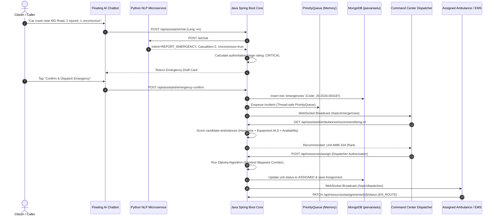
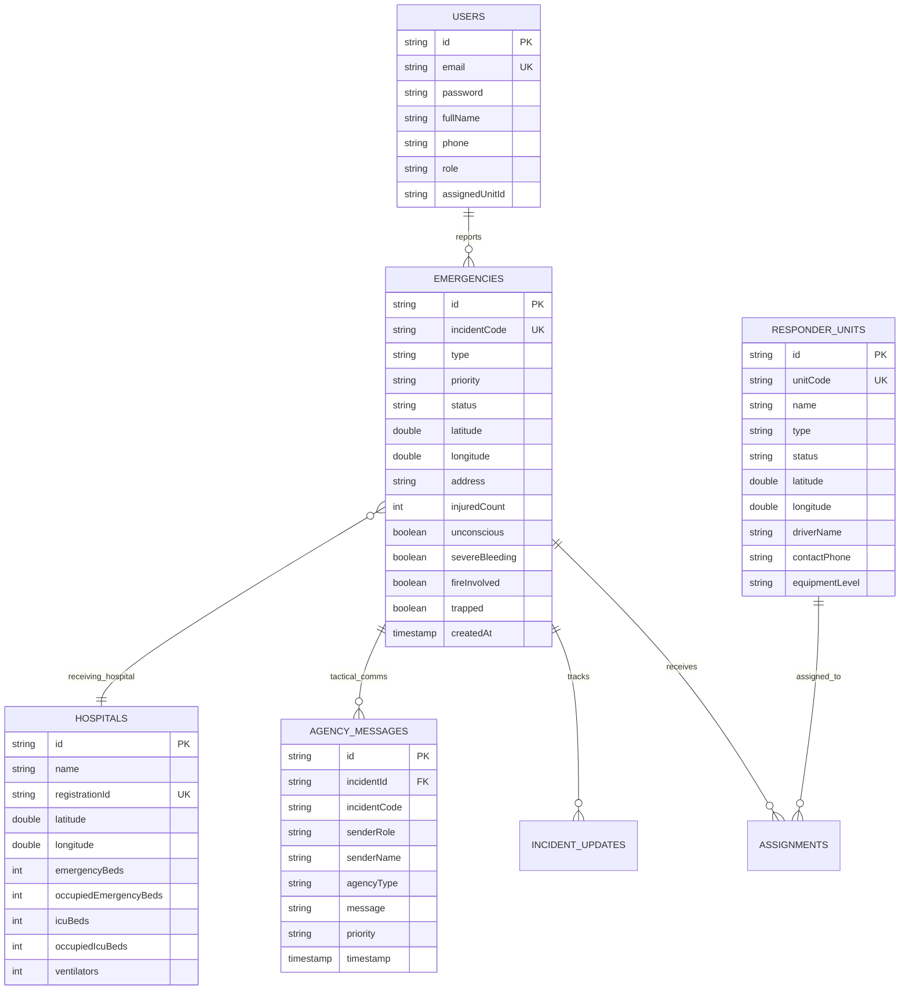

# 🏗️ JeevanSetu — Technical System Architecture & Algorithmic Designs

This document provides in-depth architectural and algorithmic documentation for the **JeevanSetu** Emergency Response & Multi-Agency Resource Coordination Platform.

---

## 1. High-Level System Architecture

```mermaid
graph TD
    subgraph Clients["Frontend Layer (HTML5, Tailwind, Leaflet, Web Speech)"]
        CitizenPortal["Citizen Portal & Floating AI"]
        CommandCenter["Command Operations Center"]
        ResponderTerminal["Mobile Responder Terminal"]
        HospitalPortal["Hospital Trauma Portal"]
    end

    subgraph Gateway["API & Security Layer"]
        SecurityConfig["Spring Security 6 (Stateless JWT)"]
        WebSocketBroker["Spring STOMP WebSocket Broker"]
    end

    subgraph JavaCore["Authoritative Backend (Java 21 / Spring Boot 3.3.4)"]
        PriorityEngine["Triage Rule Engine"]
        PriorityQueue["PriorityQueue (Triage Memory Queue)"]
        SuitabilityScorer["Multi-Factor Resource Scorer"]
        DijkstraRouter["Dijkstra Road Graph Router"]
        EmergencyService["Emergency & SOS Lifecycle"]
        AgencyCommsService["Multi-Agency Comms Engine"]
        AnalyticsService["Real-Time Analytics Engine"]
    end

    subgraph AIMicroservice["AI Microservice (Python FastAPI)"]
        MultilingualNLP["Multilingual Intent Classifier (EN, HI, TE, TA)"]
        EntityExtractor["Entity & Clinical Urgency Extractor"]
        DispatcherSummary["Incident Summarizer (Facts vs Uncertainties)"]
    end

    subgraph DataLayer["Persistence Layer"]
        MongoDB[(MongoDB 8.0: jeevansetu DB)]
        GeospatialIdx["2dsphere Geospatial Indexing"]
    end

    CitizenPortal -->|REST / WebSocket| Gateway
    CommandCenter -->|REST / WebSocket| Gateway
    ResponderTerminal -->|REST / WebSocket| Gateway
    HospitalPortal -->|REST / WebSocket| Gateway

    Gateway --> JavaCore
    JavaCore -->|HTTP REST Client (JSON)| AIMicroservice
    JavaCore -->|Spring Data MongoDB| DataLayer
```

---

## 2. Emergency Intake & Dispatch Sequence Diagram



---

## 3. Database Entity-Relationship (ER) Model



---

## 4. Multi-Factor Resource Suitability Formula

Candidate responder units are ranked using the deterministic scoring equation implemented in [`ResourceSuitabilityScorer.java`](file:///C:/Users/V%20CHETAN/.gemini/antigravity/scratch/JeevanSetu/backend-java/src/main/java/com/jeevansetu/algorithm/ResourceSuitabilityScorer.java):

$$\text{Total Score} = S_{\text{dist}} + S_{\text{avail}} + S_{\text{compat}} + S_{\text{cap}} + S_{\text{workload}}$$

Where:
- $S_{\text{dist}} = 40 \times \max\left(0, 1 - \frac{d}{25}\right)$ ($d$ is the Haversine spherical distance in kilometers).
- $S_{\text{avail}} = 30$ if unit is `AVAILABLE`, $10$ if `EN_ROUTE`.
- $S_{\text{compat}} = 15$ if vehicle equipment matches emergency trauma tier (e.g. ALS for Critical, BLS for High).
- $S_{\text{cap}} = 10$ if patient capacity $\ge$ casualties reported.
- $S_{\text{workload}} = 5$ if unit has zero prior open assignments in the shift.
